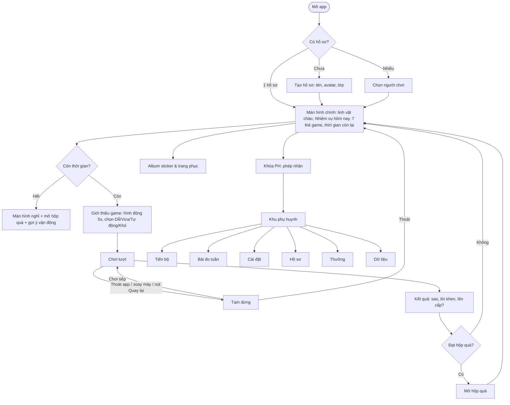
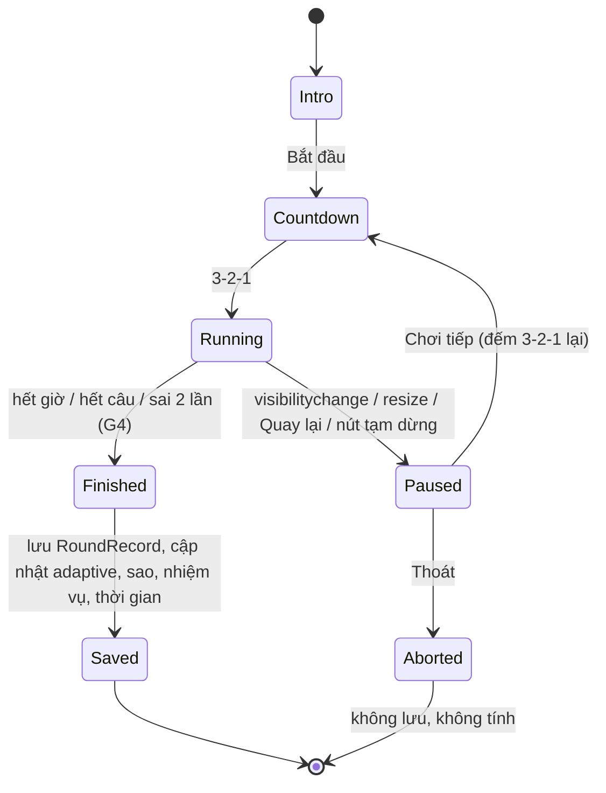

# 01_SPEC – Đặc tả hệ thống “Nhanh Tay Tinh Mắt” (v1.2)

> Nguồn: Excel `Game_NhanhTayTinhMat_PhanTich_KeHoach_v1.2.xlsx` (sheet 1–7). Mã yêu cầu F/NF/UI trùng với Excel.
> Ngày: 10/10/2026. Người dùng chính: bé 8 tuổi (Lớp 2) + phụ huynh. Có anh chị em dùng chung máy.
> Thiết bị: điện thoại Android + máy tính bảng Samsung Galaxy Tab, trình duyệt Chrome. Không hỗ trợ iPad/iPhone.

## 0. Thuật ngữ

| Thuật ngữ | Nghĩa |
|---|---|
| Lượt (round) | Một lần chơi trọn vẹn 1 game (vd 60 giây G1, 1 bảng G2, 10 câu G6) |
| Cấp (level) | 1–10, mỗi game có bảng cấp riêng (`docs/data/levels.json`) |
| score | Điểm lượt 0–1, dùng cho độ khó thích ứng và sao |
| Chế độ Tự động / Cố định | Độ khó thích ứng theo kết quả / phụ huynh khóa 1 cấp |
| Bài đo chuẩn (benchmark) | Lượt chơi ở cấu hình cố định hằng tuần để so sánh tiến bộ |
| Khu phụ huynh (PH) | Vùng cài đặt + báo cáo, khóa bằng phép tính |
| PWA | Progressive Web App – web cài lên màn hình chính, chạy offline |

## 1. Sơ đồ màn hình



| Màn hình | Route | Thành phần chính | Ghi chú |
|---|---|---|---|
| Chọn người chơi | `#/profiles` | Lưới avatar lớn + tên, nút “+” (tạo mới) | Bỏ qua nếu chỉ 1 hồ sơ |
| Tạo/sửa hồ sơ | `#/profiles/new` | Tên (≤ 12 ký tự), 12 avatar SVG, chọn Lớp 1/2/3 | Xóa hồ sơ chỉ trong khu PH |
| Màn hình chính | `#/home` | Linh vật Sóc Bo chào “Chào {tên}!”, 3 ô nhiệm vụ, 7 thẻ game chia 3 nhóm, thanh thời gian còn lại, tổng sao, nút Album, nút đổi người chơi, nút PH (icon nhỏ góc), banner “Thử thách tuần”, banner “Cập nhật” | Thẻ game: icon lớn + tên + cấp hiện tại + sao tốt nhất |
| Giới thiệu game | `#/play/:id/intro` | Hình động ≤ 5s, 1 câu hướng dẫn, nút Dễ/Vừa/Tự động/Khó (nếu PH cho phép), nút Bắt đầu to | Lần đầu chơi game: tự phát hình động |
| Chơi | `#/play/:id` | Đếm ngược 3-2-1, vùng chơi, thanh thời gian/tiến độ, nút tạm dừng (góc, ≥ 48px) | Toàn màn hình |
| Kết quả | `#/result` | 1–3 sao bay vào, lời khen theo nỗ lực, chỉ số chính, “Lên cấp!”, nút Chơi lại / Về nhà | Không hiện số lỗi theo kiểu chê |
| Hộp quà | modal | Hộp lắc → bung → sticker + độ hiếm | Mở được cả khi hết giờ |
| Album | `#/album` | 40 ô sticker (ô chưa có là bóng mờ), tab Trang phục/Hình nền | Chọn trang phục linh vật |
| Màn hình nghỉ | `#/rest` | Linh vật ngủ, nút “Con nghỉ đây” (thưởng 30s), gợi ý vận động, hộp quà còn lại | Thẻ game khóa đến 0:00 hôm sau |
| Khóa PH | `#/parent-gate` | Phép nhân 2 chữ số × 1 chữ số, bàn phím số | Sai 3 lần khóa 30s |
| Khu PH | `#/parent/*` | 6 tab: Tiến bộ, Bài đo tuần, Cài đặt, Hồ sơ, Thưởng, Dữ liệu | Chữ thường, không cần hoạt hình |

## 2. Yêu cầu (đồng bộ Excel sheet 3)

| ID | Nhóm | Yêu cầu | Ưu tiên | Nguồn |
|---|---|---|---|---|
| F01 | Chức năng | Màn hình chính: 7 thẻ game lớn chia 3 nhóm (Phản xạ / Tập trung & Trí nhớ / Học mà chơi), linh vật chào bé bằng tên, khu “Nhiệm vụ hôm nay”. | Cao | v1.0, cập nhật v1.1 |
| F02 | Chức năng | Hồ sơ bé: tên, avatar, lớp (1–3); tối đa 5 hồ sơ (anh chị em dùng chung máy). Sao, tiến độ, độ khó và thời gian chơi tách riêng từng hồ sơ. | Cao | R03 |
| F03 | Chức năng | Sao 1–3/lượt (1 sao khi hoàn thành lượt – khen nỗ lực; 2 sao khi điểm ≥ 70%; 3 sao khi ≥ 90%). Tổng sao đạt mốc mở khóa trang phục/hình nền/linh vật. | Cao | v1.0 |
| F04 | Chức năng | Độ khó thích ứng 10 cấp/game: TB 3 lượt gần nhất ≥ 85% → tăng 1 cấp; TB ≤ 55% hoặc 2 lượt liên tiếp < 50% → giảm 1 cấp. Giữ tỷ lệ thành công ~70–80%. | Cao | R11 |
| F05 | Chức năng | Hướng dẫn bằng hình động ≤ 5 giây trước mỗi game, chữ ngắn + icon; nút “Xem lại hướng dẫn”. | Cao | R02 |
| F06 | Chức năng | Bảng tiến bộ cho phụ huynh: biểu đồ chỉ số theo ngày của từng game, hiện kèm cấp độ đã chơi. | Cao | v1.0 |
| F07 | Chức năng | Giới hạn thời gian chơi/ngày/hồ sơ (mặc định 15 phút, chỉnh 5–60). Còn 2 phút: nhắc nhẹ. Hết giờ: kết thúc lượt đang chơi → màn hình nghỉ, khóa thẻ game đến hôm sau. | Cao | R10 |
| F08 | Chức năng | Khu phụ huynh khóa bằng phép nhân 2 chữ số × 1 chữ số (vd 34 × 7); sai 3 lần khóa 30 giây. | Trung bình | R19 |
| F09 | Chức năng | Âm thanh, nhạc, rung phản hồi (rung thật trên điện thoại; tablet không có mô-tơ rung → lắc hình nhẹ); bật/tắt riêng. Tự tạm dừng khi thoát app, xoay máy, có cuộc gọi; lượt dở dang bị hủy không tính. | Trung bình | R06, R25 |
| F10 | Chức năng | Lưu tiến độ trên máy; sao lưu ra file / khôi phục từ file; nhắc sao lưu nếu > 14 ngày chưa sao lưu; cảnh báo việc xóa dữ liệu trình duyệt/ẩn danh. | Trung bình | R07 |
| F11 | Chức năng | Cài đặt độ khó từng game (phụ huynh): chế độ Tự động (thích ứng, giới hạn cấp min–max) hoặc Cố định (chọn cấp 1–10) + tùy chọn riêng của game (vd G1 số màu bóng 2/3/4). Xem sheet 7. | Cao | R01, R11 |
| F12 | Chức năng | Bé chọn nhanh Dễ / Vừa / Tự động / Khó ở màn giới thiệu game (Dễ = cấp hiện tại −2, Khó = +2; lượt không ở chế độ Tự động không làm đổi cấp). Phụ huynh có thể tắt quyền này. | Trung bình | R11 |
| F13 | Chức năng | Nhiệm vụ hôm nay: hoàn thành 1 lượt ở mỗi nhóm (Phản xạ, Tập trung & Trí nhớ, Học mà chơi) → nhận 1 Hộp quà bí mật. | Cao | R09, R10 |
| F14 | Chức năng | Hộp quà bí mật & album sticker (40 sticker: Thường 70%, Hiếm 25%, Siêu hiếm 5%; bảo đảm Hiếm sau 5 hộp; trùng → +3 sao). Nhận hộp khi xong nhiệm vụ hoặc mỗi 15 sao; tối đa 3 hộp/ngày (phụ huynh chỉnh 0–5). Hộp mở được cả khi đã hết giờ. | Cao | R10 |
| F15 | Chức năng | Phụ huynh thưởng khi bé học tốt/ngoan ngoài đời: tặng thêm thời gian (+5/+10/+15 phút hôm nay) hoặc tặng hộp quà (ghi lý do). Hộp phụ huynh tặng không tính vào giới hạn ngày. | Trung bình | R10 |
| F16 | Chức năng | Bài đo chuẩn hàng tuần: 1 lượt/game ở cấu hình cố định (không theo độ khó thích ứng) để so sánh tuần 1 với tuần 4. Màn hình chính hiện “Thử thách tuần” nếu 7 ngày chưa làm. | Cao | R01, R16 |
| F17 | Chức năng | Nội dung toán G6 theo lớp (mặc định Lớp 2) và chủ đề phụ huynh bật/tắt (M01–M14, xem sheet 7). | Cao | R09, R20 |
| F18 | Chức năng | Biểu đồ lọc theo hồ sơ và loại thiết bị (điện thoại / máy tính bảng); mỗi bản ghi lưu deviceId + deviceClass. | Trung bình | R12 |
| F19 | Chức năng | Sổ lỗi toán: phép tính bé làm sai được hỏi lại sau 2–4 câu và ở đầu lượt kế tiếp; đủ 3 lần đúng liên tiếp → “đã thuộc”. | Trung bình | R09 |
| F20 | Chức năng | Thưởng “Nghỉ đúng giờ”: khi hết giờ, bé bấm “Con nghỉ đây” trong 30 giây → +2 sao. Màn hình nghỉ gợi ý vận động thực tế (nhảy dây, ném bóng, xếp Lego). | Trung bình | R09, R10, R15 |
| NF01 | Phi chức năng | Chạy tốt trên Chrome Android (≥ 2 bản gần nhất) ở điện thoại Android và máy tính bảng Samsung Galaxy Tab; Samsung Internet hỗ trợ cơ bản. Cài được lên màn hình chính. Không hỗ trợ iPad/iPhone. | Cao | R21 |
| NF02 | Phi chức năng | Giao diện co giãn: điện thoại dọc 360px đến tablet Samsung ngang ~1340px (cả dọc và ngang); tôn trọng vùng an toàn (camera đục lỗ, thanh điều hướng Android). | Cao | R21 |
| NF03 | Phi chức năng | Phản hồi chạm tức thì; hoạt ảnh 60 khung hình/giây; thời gian phản ứng đo bằng event.timeStamp so với thời điểm kích thích được vẽ, không theo khung hình. | Cao | R08 |
| NF04 | Phi chức năng | Vùng chạm tối thiểu 48px (nút chính ≥ 64px); khoảng cách giữa nút ≥ 8px. | Cao | v1.0 |
| NF05 | Phi chức năng | Không quảng cáo, không mua hàng, không link ngoài, không gửi dữ liệu ra ngoài máy; không thư viện theo dõi/analytics. | Cao | v1.0 |
| NF06 | Phi chức năng | PWA (Progressive Web App): chơi được hoàn toàn khi không có mạng sau lần mở đầu; mọi tài nguyên (font, âm thanh, hình) đóng gói sẵn, không dùng CDN. | Cao | R14 |
| NF07 | Phi chức năng | Host GitHub Pages (HTTPS). Có bản mới: chỉ thông báo “Cập nhật” ở màn hình chính/khu phụ huynh, không tự tải lại giữa lượt chơi; dữ liệu giữ nguyên qua các bản (migration). | Trung bình | R14, R18 |
| NF08 | Phi chức năng | Mã nguồn Vite + TypeScript (strict); logic thuần (độ khó, chấm điểm, sinh câu hỏi) có unit test Vitest; e2e Playwright (Chromium) ở khung hình điện thoại và tablet Samsung. | Trung bình | Quyết định v1.1 |
| NF09 | Phi chức năng | Dữ liệu: localStorage có try/catch + phiên bản schema; xin quyền lưu trữ bền (navigator.storage.persist); lượt chơi chi tiết giữ 120 ngày, tổng hợp theo ngày giữ vĩnh viễn. | Trung bình | R07, R17 |
| NF10 | Phi chức năng | Nút/cử chỉ Quay lại của Android: đang chơi → tạm dừng; màn hình khác → về màn trước; màn hình chính → nhắc “Bấm lần nữa để thoát” (dùng History API với hash route). | Trung bình | R23 |
| NF11 | Phi chức năng | Hỗ trợ tablet Samsung: chia đôi màn hình/cửa sổ nổi → tạm dừng + sắp lại bố cục, cửa sổ rộng < 360px hiện “Mở toàn màn hình để chơi”; S Pen (pointerType = pen) xử lý như chạm. | Thấp | R24 |
| UI01 | Đồ họa | Phong cách hoạt hình tươi sáng, linh vật gốc “Sóc Bo” (SVG tự vẽ), hiệu ứng sao/pháo hoa khi làm đúng. | Cao | v1.0 |
| UI02 | Đồ họa | Khi sai: phản hồi nhẹ nhàng (rung nhẹ, lời động viên), không âm thanh chê, không trừ sao đã có. | Cao | v1.0 |
| UI03 | Đồ họa | Chữ to (≥ 18px, tiêu đề ≥ 28px), tiếng Việt, luôn kèm icon/hình động; màu luôn đi kèm hình dạng (hỗ trợ mù màu). | Trung bình | R02 |
| UI04 | Đồ họa | Chỉ dùng hình, nhân vật, nhạc tự thiết kế; không dùng nhân vật/bài hát có bản quyền. Font Nunito (hỗ trợ tiếng Việt) đóng gói sẵn. | Trung bình | v1.1 |

## 3. Vòng đời một lượt chơi



- Thời gian chơi trong ngày chỉ cộng khi ở trạng thái `Running`.
- Hết giờ trong ngày khi đang `Running`: cho chơi nốt lượt (tối đa thêm 90 giây; G6/G7 kết thúc sau câu hiện tại), rồi lưu và chuyển `#/rest`.

## 4. Giao diện chung cho game (GameModule)

```ts
export type GameId = 'G1' | 'G2' | 'G3' | 'G4' | 'G5' | 'G6' | 'G7';

export interface GameContext {
  level: number;                       // 1–10 đã áp dụng (sau Dễ/Khó hoặc chế độ Cố định)
  options: Record<string, unknown>;    // tùy chọn PH của game (vd { colors: 4 })
  profile: { grade: 1 | 2 | 3; mathTopics: string[]; mathFacts: Record<string, MathFact> };
  rng: () => number;                   // RNG có seed
  audio: AudioApi; haptics: HapticsApi;
  benchmark: boolean;
  onFinish(result: RoundResult): void;
}

export interface GameInstance { start(): void; pause(): void; resume(): void; destroy(): void; }
export interface GameModule { id: GameId; create(host: HTMLElement, ctx: GameContext): GameInstance; }

export interface RoundResult {
  score: number;                        // 0–1
  durationMs: number;                   // thời gian Running thực tế
  metrics: Record<string, number>;      // chỉ số riêng từng game (docs/02_GAMES.md)
  extra?: Record<string, unknown>;      // vd danh sách phép tính sai (G6)
}
```

## 5. Mô hình dữ liệu (localStorage)

Khóa lưu trữ: `ntm.state` (AppState), `ntm.rounds.<profileId>` (RoundRecord[]), `ntm.daily.<profileId>` (DailyAggregate[]).

```ts
interface AppState {
  schemaVersion: 3;                    // 1 → 2 (TASK-07): thêm Profile.rewardLog · 2 → 3 (TASK-10): thêm Profile.mascotId, soundSetId
  deviceId: string;                    // uuid tạo lần đầu
  activeProfileId: string | null;
  profiles: Profile[];                 // tối đa 5
  settings: GlobalSettings;
  lastBackupAt: string | null;         // ISO
  installedVersion: string;
}

interface GlobalSettings {
  sound: boolean; music: boolean; vibration: boolean;
  allowKidDifficultyChoice: boolean;   // F12, mặc định true
}

interface Profile {
  id: string; name: string; avatarId: string; grade: 1 | 2 | 3; createdAt: string;
  limits: { dailyMinutes: number; maxBoxesPerDay: number };   // mặc định 15, 3
  totalStars: number;                  // không bao giờ giảm
  unlocked: string[];                  // id phần thưởng theo mốc sao
  outfitId: string | null; backgroundId: string | null;
  mascotId: string | null;             // null = Sóc Bo; 'mascot-owl' = Cú Mèo (chỉ khi đã mở khóa, bé tự chọn ở Album → Đặc biệt)
  soundSetId: string | null;           // null = âm gốc; 'sound-percussion' = Nhạc Cụ Gõ (chỉ khi đã mở khóa)
  stickers: Record<string, number>;    // stickerId -> số lượng
  boxes: { pending: number; openedTotal: number; sinceLastRare: number };
  games: Record<GameId, GameProgress>;
  math: { topics: string[]; facts: Record<string, MathFact> };  // F17, F19
  days: Record<string, DayUsage>;      // khóa 'YYYY-MM-DD' theo giờ máy
  lastBenchmarkAt: string | null;      // lần làm ĐỦ 7 game bài đo của tuần (banner “Thử thách tuần”)
  rewardLog: RewardLogEntry[];         // nhật ký phụ huynh thưởng (F15), giữ 50 mục mới nhất
}

interface RewardLogEntry {
  at: string;                          // ISO
  kind: 'time' | 'box';
  amount: number;                      // phút hoặc số hộp
  reason: 'goodStudy' | 'wellBehaved' | 'chores' | 'other';
}

interface GameProgress {
  mode: 'auto' | 'fixed';
  level: number;                       // cấp tự động hiện tại (hoặc cấp cố định)
  minLevel: number; maxLevel: number;  // giới hạn cho chế độ auto
  recentScores: number[];              // tối đa 3, chỉ lượt ở chế độ auto + lựa chọn 'Tự động'
  options: Record<string, unknown>;    // tùy chọn riêng game
  bestStars: number; plays: number;
}

interface MathFact { seen: number; correct: number; streak: number; lastSeenRound: number; mastered: boolean; }

interface DayUsage {
  playMs: number; bonusMs: number;     // thời gian đã chơi / được PH tặng
  missions: { reflex: boolean; focus: boolean; learn: boolean; rewarded: boolean };
  boxesEarned: number;                 // không tính hộp PH tặng
  starsToday: number; restOnTimeRewarded: boolean;
}

interface RoundRecord {
  id: string; profileId: string; gameId: GameId; startedAt: string;
  level: number; mode: 'auto' | 'fixed' | 'easy' | 'normal' | 'hard'; benchmark: boolean;
  options: Record<string, unknown>; durationMs: number;
  score: number; stars: 1 | 2 | 3; metrics: Record<string, number>;
  deviceId: string; deviceClass: 'phone' | 'tablet';      // F18
}

interface DailyAggregate {  // giữ vĩnh viễn; RoundRecord chỉ giữ 120 ngày
  date: string; gameId: GameId; deviceClass: 'phone' | 'tablet';
  rounds: number; avgScore: number; avgLevel: number; metrics: Record<string, number>; // trung bình
}
```

- `deviceClass`: `tablet` nếu cạnh ngắn của **màn hình** (`screen.width/height`, không dùng kích thước cửa sổ vì có thể đang chia đôi màn hình) ≥ 600 CSS px, ngược lại `phone`.
- “Ngày” tính theo giờ địa phương của máy, đổi ngày lúc 00:00. **App đang mở thì vẫn tự sang ngày mới** (TASK-09): `app/today.ts` có signal `today`, làm mới lúc 00:00 và mỗi khi app hiện lại/lấy lại tiêu điểm (máy ngủ qua đêm); Home và việc khóa theo giờ đọc từ đây.
- **Đọc dữ liệu có kiểm tra** (TASK-09, `app/validate.ts`): khi mở app, khi đọc lượt chơi/tổng hợp ngày và khi khôi phục từ file sao lưu, mọi phần tử được kiểm; lượt/tổng hợp thiếu thông tin cốt lõi (game, ngày, điểm) bị bỏ, trường thiếu hoặc sai kiểu trong hồ sơ/cài đặt được thay bằng giá trị mặc định (dữ liệu hợp lệ giữ nguyên 100%). Hồ sơ không nhận ra được (thiếu `id`/`name`, trùng `id`): khi mở app thì bỏ hồ sơ đó nhưng **giữ bản gốc ở `ntm.state.bak`**; khi khôi phục thì **từ chối cả file**.
- `DailyAggregate` dựng từ các `RoundRecord` còn giữ (tính lại các ngày có lượt chi tiết, giữ nguyên ngày cũ đã bị dọn); **không gồm lượt bài đo** (chạy ở cấp cố định, xem tab “Bài đo tuần”). `RoundRecord` chi tiết giữ 120 ngày; **riêng lượt bài đo (`benchmark: true`) giữ mãi** để còn so sánh với tuần đầu. Việc này chạy khi mở app và sau mỗi lượt (`maintainRounds` trong `store.ts`).
- Kích thước ước tính: ~200 byte/lượt × ~10 lượt/ngày × 120 ngày × 5 hồ sơ ≈ 1,2 MB (< giới hạn 5 MB).
- Gọi `navigator.storage?.persist?.()` sau khi tạo hồ sơ đầu tiên.

## 6. Độ khó thích ứng (F04, F11, F12)

```ts
// adaptive.ts – thuần, có test
function levelForRound(g: GameProgress, kidChoice: 'easy'|'normal'|'auto'|'hard'): number {
  if (g.mode === 'fixed') return g.level;
  const base = g.level;
  if (kidChoice === 'easy') return clamp(base - 2, 1, 10);
  if (kidChoice === 'hard') return clamp(base + 2, 1, 10);
  return base;                                   // 'auto' và 'normal' đều chơi ở cấp hiện tại
}
function afterRound(g: GameProgress, score: number, countsForAdaptive: boolean): GameProgress {
  if (g.mode === 'fixed' || !countsForAdaptive) return g;   // chỉ lượt 'auto' mới tính
  const s = [...g.recentScores, score].slice(-3);
  const avg = mean(s);
  const twoLow = s.length >= 2 && s.at(-1)! < 0.5 && s.at(-2)! < 0.5;
  if (s.length === 3 && avg >= 0.85) return { ...g, level: Math.min(g.level + 1, g.maxLevel), recentScores: [] };
  if ((s.length === 3 && avg <= 0.55) || twoLow) return { ...g, level: Math.max(g.level - 1, g.minLevel), recentScores: [] };
  return { ...g, recentScores: s };
}
```

- Lựa chọn “Vừa” = chơi ở cấp hiện tại nhưng **không** tính vào adaptive; “Tự động” (mặc định, có ngôi sao gợi ý) thì tính.
- Bài đo chuẩn không tính vào adaptive.
- Lên cấp: hiệu ứng “Lên cấp!” ở màn kết quả. Xuống cấp: **không** thông báo tiêu cực; chỉ đổi cấp lặng lẽ, lời khen nỗ lực.

## 7. Sao, nhiệm vụ, hộp quà, mở khóa (F03, F13, F14, F15, F20)

| Quy tắc | Giá trị |
|---|---|
| Sao/lượt | 1 (hoàn thành) · 2 (score ≥ 0,70) · 3 (score ≥ 0,90) |
| Nhiệm vụ hôm nay | Phản xạ (G1/G3/G5) + Tập trung & Trí nhớ (G2/G4) + Học mà chơi (G6/G7), mỗi nhóm 1 lượt hoàn thành → 1 hộp quà |
| Hộp theo sao | Mỗi khi `totalStars` vượt bội số 15 → 1 hộp |
| Giới hạn hộp/ngày | `maxBoxesPerDay` (mặc định 3, PH chỉnh 0–5); hộp PH tặng không tính |
| Vượt giới hạn | Không nhận thêm, thông báo “Mai con nhận tiếp nhé!” |
| Độ hiếm | Thường 70% (24 sticker) · Hiếm 25% (12) · Siêu hiếm 5% (4) |
| Bảo đảm | `sinceLastRare ≥ 5` → hộp kế tiếp tối thiểu Hiếm |
| Trùng sticker | Đổi thành +3 sao (vẫn tăng số lượng để hiện “×2”) |
| Nghỉ đúng giờ | Hết giờ, bấm “Con nghỉ đây” trong 30s → +2 sao (1 lần/ngày) |
| Mốc mở khóa | 10 sao → Khung avatar Cầu Vồng; 25 sao → Trang phục linh vật: Mũ Phi Công; 50 sao → Hình nền: Rừng Kẹo; 80 sao → Bộ âm thanh: Nhạc Cụ Gõ; 120 sao → Trang phục linh vật: Áo Siêu Nhân Sóc (thiết kế gốc); 170 sao → Hình nền: Đáy Biển; 230 sao → Linh vật thứ 2: Cú Mèo Thông Thái; 300 sao → Huy hiệu Vàng “Nhanh Tay Tinh Mắt” |

Sticker: 40 hình SVG tự vẽ, chủ đề động vật – trái cây – vũ trụ – phương tiện. Đặt tên `stk-01` … `stk-40`, độ hiếm khai báo trong `rewards.ts`.

## 8. Thời gian chơi (F07)

- Giới hạn theo **hồ sơ / ngày**: `dailyMinutes` (mặc định 15, chỉnh 5–60) + `bonusMs` PH tặng hôm nay.
- Chỉ cộng thời gian khi lượt ở trạng thái `Running`.
- Còn 2 phút: banner nhẹ “Còn 2 phút nữa thôi nhé!” (không ngắt lượt).
- Hết giờ: xem mục 3. Màn hình nghỉ gợi ý vận động ngẫu nhiên từ danh sách: nhảy dây 2 phút, tung bắt bóng, xếp Lego, vẽ tranh, giúp mẹ việc nhà.
- Khu PH, Album, mở hộp quà vẫn dùng được khi hết giờ.

## 9. Khu phụ huynh

| Tab | Chức năng |
|---|---|
| Tiến bộ (F06, F18) | Chọn hồ sơ → game → chỉ số; biểu đồ đường theo ngày (7/30 ngày/tất cả), đường phụ hiển thị cấp; lọc thiết bị “Điện thoại / Máy tính bảng / Tất cả”; bảng 10 lượt gần nhất |
| Bài đo tuần (F16) | Thẻ “So sánh tuần đầu ↔ tuần gần nhất” cho 7 game (mũi tên ↑↓, màu xanh = tiến bộ, chú ý chiều “thấp hơn là tốt” với thời gian phản ứng/thời gian hoàn thành); nút “Bắt đầu bài đo cho bé” |
| Cài đặt (F07, F11, F12, F17) | Thời gian/ngày, hộp quà tối đa/ngày, âm thanh/nhạc/rung, cho bé chọn độ khó; từng game: Tự động (min–max) / Cố định (cấp) + tùy chọn riêng; G6: lớp, chủ đề M01–M14 |
| Hồ sơ (F02) | Thêm/sửa/xóa (xác nhận 2 bước, gõ tên để xóa) |
| Thưởng (F15) | Tặng +5/+10/+15 phút hôm nay; tặng hộp quà (lý do: Học tốt / Ngoan / Giúp việc nhà / Khác) |
| Dữ liệu (F10, NF07) | **Xuất CSV (TASK-10)** của hồ sơ đang xem: `nhanhtay-lichsu-<tên>-YYYYMMDD.csv` (từng lượt, mỗi chỉ số một cột) và `nhanhtay-tonghop-<tên>-YYYYMMDD.csv` (tổng hợp theo ngày); UTF-8 có BOM + dòng `sep=,` để Excel/Google Trang tính đọc đúng tiếng Việt và tách cột. Sao lưu → file `nhanhtay-backup-YYYYMMDD.json` (Blob + `a[download]`, lưu vào thư mục Tải xuống của máy); Khôi phục (chọn file → xem trước số hồ sơ/lượt → xác nhận ghi đè); cảnh báo xóa dữ liệu trình duyệt/ẩn danh; nhắc nếu > 14 ngày chưa sao lưu; phiên bản app; ghi chú R13 (khi nào nên đi khám) |

Khóa PH (F08): phép nhân `a × b` với a ∈ [12, 49], b ∈ [3, 9]; bàn phím số trên màn hình; sai 3 lần → khóa 30s.

## 10. Bài đo chuẩn (F16)

- Cấu hình cố định theo cột “Bài đo chuẩn” (`levels.json → benchmark`), tùy chọn mặc định, G6 dùng chủ đề mặc định của lớp hồ sơ.
- Thứ tự: G1 → G2 → G3 → G4 → G5 → G6 → G7 (khoảng 8–10 phút). Có thể làm nhiều buổi trong 1 tuần.
- Banner “Thử thách tuần” trên Home khi `lastBenchmarkAt` > 7 ngày hoặc chưa có.
- Lượt bài đo được +sao như thường, **không** tính adaptive, có cờ `benchmark: true`. Thời gian bài đo **có** tính vào giới hạn ngày (PH có thể tặng thêm giờ).

## 11. PWA, offline, cập nhật, deploy (NF06, NF07)

- `vite-plugin-pwa`: precache toàn bộ asset build (JS, CSS, font, SVG, icon). Không có request mạng lúc chạy.
- Manifest: `name` “Nhanh Tay Tinh Mắt”, `short_name` “Nhanh Tay”, `display: standalone`, `orientation: any`,
  `background_color`/`theme_color` theo theme, icon 192/512 + maskable. Không cần meta riêng cho iOS.
- `base` của Vite = `/<tên-repo>/` (lấy từ biến môi trường trong workflow); router dùng hash để chạy dưới đường dẫn con.
- Cập nhật: `registerType: 'prompt'` → khi có SW mới, set cờ `updateAvailable`; Home/khu PH hiện nút “Có bản mới – Cập nhật”. Không bao giờ reload trong lúc chơi.
- Deploy: `.github/workflows/deploy.yml` (push `main` → build → `actions/upload-pages-artifact` → `actions/deploy-pages`).
- Lưu ý Android: dữ liệu gắn với trình duyệt đã cài (Chrome ≠ Samsung Internet) → cài và chơi bằng Chrome, luôn mở từ icon (ghi trong hướng dẫn). App cài bằng Chrome được cấp lưu trữ bền khi gọi `navigator.storage.persist()`.

## 12. Âm thanh, rung, đồ họa

- **Linh vật**: “Sóc Bo” – sóc nhỏ màu cam, đuôi to, mắt tròn; SVG tự vẽ với 5 biểu cảm (chào, vui, cổ vũ, ngạc nhiên, ngủ). Linh vật thứ 2 “Cú Mèo Thông Thái” mở khóa ở 230 sao.
- **Bảng màu** (rực rỡ, nhiều tông nổi bật; chữ luôn tối `#263238` trên nền sáng/vừa để đạt tương phản AA; màu luôn kèm hình dạng): nền chuyển sắc trời → kem → hồng nhạt `#BDE9FF → #FFF1C7 → #FFD9EC`; xanh trời `#29B6F6`, xanh lá `#3DDC6E`, vàng `#FFD93D`, cam `#FF8A3D`, hồng `#FF5FA2`, tím `#8E6CF0`, ngọc `#18C9B9`, đỏ `#FF4D5E`; mỗi màu có bản nhạt (`*-soft`) cho nền thẻ. Mỗi game có tông riêng trên Home: G1 cam, G3 vàng, G5 hồng, G2 tím, G4 xanh trời, G6 xanh lá, G7 ngọc. Nút chính dạng “kẹo” (chuyển sắc cam + bóng đổ). Chi tiết ở `src/ui/theme.css`.
- **G1 mã hóa màu + hình**: xanh = tròn + mặt cười; đỏ = vuông + dấu ✕; vàng = tam giác + dấu !; nâu = thoi + dấu ~.
- **Âm thanh**: Web Audio tổng hợp: chạm đúng (ding cao), sai (bụp nhỏ, trầm nhẹ – không chê), sao (arpeggio), lên cấp (fanfare ngắn), 9 nốt cho G4/G5 (âm giai ngũ cung C D E G A).
  Mở khóa AudioContext ở lần chạm đầu (`resume()` trong `pointerdown`).
- **Rung**: `navigator.vibrate(30)` đúng, `[15,40,15]` sai (điện thoại). Tablet Samsung thường không có mô-tơ rung → **luôn** kèm hiệu ứng lắc hình (CSS shake 150ms) trên mọi thiết bị.
- **Hiệu ứng**: sao bay, confetti khi 3 sao/lên cấp; tôn trọng `prefers-reduced-motion` (giảm hạt).
- Cỡ chữ: thân ≥ 18px, nút ≥ 22px, tiêu đề ≥ 28px.

## 12b. Xử lý riêng cho Android / tablet Samsung (NF10, NF11)

| Tình huống | Xử lý |
|---|---|
| Nút/cử chỉ Quay lại (vuốt cạnh) | Mỗi màn hình đẩy 1 mục vào `history`; `popstate` khi đang chơi → tạm dừng và đẩy lại mục; ở Home → toast “Bấm lần nữa để thoát” trong 2s, lần 2 mới cho thoát |
| Chia đôi màn hình / cửa sổ nổi | `resize` → tạm dừng, sắp lại bố cục; nếu cửa sổ rộng < 360px hoặc cao < 480px → overlay “Mở toàn màn hình để chơi” |
| S Pen | `pointerType === 'pen'` xử lý như chạm; tắt hover-only UI |
| Thanh điều hướng & camera đục lỗ | `viewport-fit=cover` + `env(safe-area-inset-*)`; không đặt nút quan trọng sát mép dưới 16px |
| Tablet ngang 1280×800 | Home (từ 1200px rộng, v0.9.2): khung tối đa 1240px; nửa trên 2 cột (lời chào + thời gian \| nhiệm vụ + hộp quà), **3 nhóm game đứng cạnh nhau trên một hàng** (7 thẻ) → vừa một màn, không phải cuộn. Ngang hẹp hơn (900–1199px): lưới thẻ 4 cột như cũ. Vùng chơi canh giữa, tối đa 1000px rộng (G5 làn tối đa 640px) |
| Tablet dọc 800×1280 | Home: lưới 3 cột; game dùng toàn chiều rộng |
| Phóng to bằng 2 ngón (v0.9.2) | Viewport **cho phép phóng to** (accessibility), riêng **màn chơi chặn phóng** (`touch-action: none` trên cả màn chơi, gồm thanh trên và lớp phủ). Nếu trang đang bị phóng khi vào game (bé phóng ở màn khác) → game **tạm dừng + nhắc “chụm 2 ngón để thu nhỏ”**, nút Chơi tiếp khóa đến khi thu nhỏ lại (`app/zoom.ts`) |
| Không có rung | Xem mục 12 – luôn có lắc hình + âm |

## 13. Phi chức năng & kiểm thử

| Mục | Mức chấp nhận |
|---|---|
| Hiệu năng | 60 fps ở G1/G3/G5 trên Android tầm trung (≥ 2020) và Galaxy Tab dòng A (tầm thấp); bundle JS gzip < 350 KB |
| Khởi động | < 2 giây khi mở offline từ icon |
| Độ trễ chạm | Phản hồi hình ảnh trong frame kế tiếp |
| Lighthouse PWA/Accessibility | ≥ 90 |
| Trình duyệt | Chrome Android 2 bản gần nhất (điện thoại + Galaxy Tab); Samsung Internet: mở được và chơi được, không bắt buộc cài PWA |
| Unit test | adaptive, scoring, rewards, rng, storage/migration, logic từng game (sinh đề G6/G7 luôn đúng 1 đáp án) |
| E2E | Tạo hồ sơ → chơi 1 lượt mỗi game (chế độ test tăng tốc) → kết quả lưu; khu PH; sao lưu/khôi phục |

Chế độ test: query `?e2e=1` cho phép tăng tốc thời gian lượt ×10 và seed RNG cố định (chỉ hoạt động khi `import.meta.env.DEV` hoặc có cờ build test).

## 14. Điểm mới v1.2 áp dụng theo đề xuất (chủ dự án có thể góp ý – Excel sheet 6)

R01–R22 đã được chủ dự án xác nhận. Các điểm dưới đây làm theo đề xuất, không chặn tiến độ:

| ID | Nội dung | Đề xuất đang áp dụng |
|---|---|---|
| R23 | Nút/cử chỉ Quay lại của Android (vuốt từ cạnh màn hình) khi đang chơi làm thoát game hoặc thoát app. | Quay lại khi đang chơi = tạm dừng; ở màn hình khác = về màn trước; ở màn hình chính = nhắc “Bấm lần nữa để thoát” (NF10). |
| R24 | Tablet Samsung có chia đôi màn hình / cửa sổ nổi / S Pen: vùng chơi bị thu nhỏ hoặc nét bút không được tính là chạm. | Đổi kích thước → tạm dừng và sắp lại bố cục; cửa sổ rộng < 360px → hiện “Mở toàn màn hình để chơi”; S Pen xử lý như ngón tay (NF11). |
| R25 | Phần lớn tablet Samsung không có mô-tơ rung nên phản hồi rung không có tác dụng. | Luôn kèm hiệu ứng rung hình (lắc nhẹ) + âm thanh; rung thật chỉ bật trên điện thoại (F09). |
